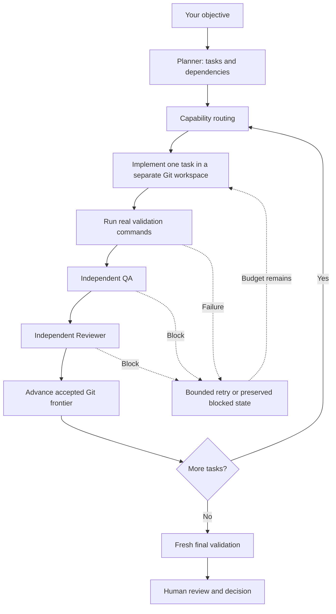

# Doom Team

[](https://github.com/erkamspyjamas/doom-team/actions/workflows/ci.yml)
[](pyproject.toml)

**A self-hosted software engineering team with real validation, independent review, and a human approval boundary.**

Give Doom Team a natural-language objective. It builds a dependency-aware task plan,
routes work to an implementation specialist, validates the actual candidate, and
asks separate QA and Reviewer roles to assess it. Accepted tasks advance a Git
frontier. The completed project receives fresh final validation and waits for
your decision.

The engine runs locally; model inference uses the configured provider. Its task
history, evidence, usage, and recovery state stay in an operator-selected directory.
It is a standalone Python package with no dependency on the older Doom Autopilot
service. Gas City is an optional execution transport.

**Project stage:** early engineering release (`0.1.0`). The current mission path
executes tasks serially. OS sandboxing, actual concurrent mission execution, and
broader real-project reliability remain open work. See [current evidence and
limits](STATUS.md) and the [prioritized work list](TODO.md); dated publication
entries there describe historical snapshots, not live repository state.

**CI status:** the publication check found lint errors in the existing source and
tests; type-checking and tests did not run in that CI attempt. Details are recorded
in [STATUS.md](STATUS.md#public-repository-check--2026-10-22).

[Quick start](#quick-start) · [How it works](#how-it-works) ·
[Operations](#operating-a-mission) · [Documentation](#documentation) ·
[Limits](#security-and-current-limits)

## What you can do

- Turn a bounded software objective into tasks with dependencies and acceptance criteria.
- Build a new project in a separate Git destination, with candidate changes and attempt history.
- Use native project tools for dependency setup, build, static checks, and tests.
- Require independent QA and Reviewer verdicts after real command execution.
- Resume interrupted missions from durable state without refilling attempt budgets.
- Inspect actual provider routes, tokens, reasoning-token counts, and reported costs offline.
- Record a human acceptance or denial tied to the delivered candidate.

Good starting objectives have a clear user, a small set of outcomes, and observable
acceptance criteria: a local utility, a small API, or a modest web application.
Large repositories and broad, underspecified rewrites can exceed the current
context and review limits.

## How it works



Planning, implementation, QA, and Reviewer are distinct calls with distinct
contracts. A passing test command does not imply that QA or Reviewer passed.
Task acceptance does not imply mission completion, and mission completion does
not imply human approval. Approval records a decision; **the mission path never
pushes, merges, publishes, or deploys the result.**

### Execution choices

| Area | Supported behavior |
|---|---|
| Engine | Installed Python 3.11 package; no third-party Python runtime dependencies |
| Task transport | `in_process` by default; optional `gas_city` worker processes |
| Generated project | Language, framework, and dependencies chosen for the objective; explicit user preferences take precedence |
| Scheduling | Dependency-aware, deterministic, serial task execution |
| Review | Separate QA and Reviewer calls, with candidate diff and validation evidence |
| Persistence | Git candidates, checksummed mission records, command evidence, verdicts, and append-only events |

The separate operator console used in the local installation is a companion
application. Its web UI is not bundled in this engine repository; installing
`doom-team` installs the CLI and workers.

## Quick start

The commands below target Linux or Ubuntu under WSL, using Bash. They do not
require the original operator's directory layout or a running Gas City instance.

### 1. Install

You need **Python 3.11**, Git, and the native toolchains/services required by the
project you intend to generate. The Python runtime is pinned to `>=3.11,<3.12`.
The default Python validation policy also needs pytest installed in the runtime.

```bash
git clone --branch main https://github.com/erkamspyjamas/doom-team.git
cd doom-team
python3.11 -m venv .venv
source .venv/bin/activate
python -m pip install -e ".[dev]" -c constraints.txt
doom-team --help
```

The dev installation supplies pytest and the engine's quality tools. For an
operator-only installation, `python -m pip install -e .` installs the engine;
provision the chosen validation tools separately. Workers must use an installed
package. Do not use `PYTHONPATH` as a substitute for installation.

### 2. Configure a provider

This example uses the two-model OpenRouter arrangement recorded in this repository:
DeepSeek plans/implements, GLM handles the initial QA/Reviewer route, and reasoning
is enabled. These are example model/provider IDs, not a guarantee of availability
or pricing. Confirm access and endpoint support in your own provider account.

```bash
# Enter the credential without putting its value in shell history.
read -r -s -p "OpenRouter API key: " OPENROUTER_API_KEY
printf '\n'
export OPENROUTER_API_KEY

export DOOM_STATE_DIR="$PWD/.doom-state/demo"
export DOOM_MODEL_PROVIDER=openrouter
export DOOM_MODEL_NAME=deepseek/deepseek-v4.1-flash-1017
export DOOM_PROVIDER_BASE_URL=https://openrouter.ai/api
export DOOM_PROVIDER_API_KEY_ENV=OPENROUTER_API_KEY
export DOOM_PROVIDER_ONLY=deepinfra/fp8

export DOOM_FALLBACK_PROVIDER=openrouter
export DOOM_FALLBACK_MODEL_NAME=z-ai/glm-5.3-flash
export DOOM_FALLBACK_BASE_URL=https://openrouter.ai/api
export DOOM_FALLBACK_API_KEY_ENV=OPENROUTER_API_KEY
export DOOM_FALLBACK_PROVIDER_ONLY=z-ai/fp8,siliconflow/fp8
export DOOM_QUALITY_MODEL_ROUTE=fallback

export DOOM_OPENROUTER_REASONING_EFFORT=high
export DOOM_OPENROUTER_MAX_TOKENS=65536
export DOOM_OPENROUTER_JSON_MODE=true
export DOOM_REQUEST_TIMEOUT=600
export DOOM_TASK_TRANSPORT=in_process
export DOOM_VALIDATION_POLICY=project

doom-team doctor
```

Keep credentials out of Git, objectives, and generated project files. Repository
content and command output needed for implementation/review are sent to the
configured model service. Review what you provide to that service.

The [configuration reference](docs/CONFIGURATION.md) documents all settings and
precedence. The [OpenRouter runbook](runbooks/OPENROUTER.md) explains reasoning,
provider restrictions, alternate model roles, and availability-only failover.
Its selected-profile launcher is specific to the original operator installation;
the environment-based example above works without that external profile file.

### 3. Give the team an objective

**This step makes paid model calls and executes generated code.** Use a dedicated
development environment. Choose a fresh state directory per new mission and a
new or empty destination outside the engine's source tree; its parent must exist.

```bash
doom-team run \
  "Build a local bookmark manager with create, search, tag, and delete flows. Choose a suitable stack. Include tests and exact launch instructions. The first task must deliver a working vertical slice and a root doom.project.json with real setup, build, checks, and test commands. Keep tasks small and independently verifiable." \
  --destination "$(dirname "$PWD")/doom-bookmarks"
```

On success, the JSON result identifies the mission and reports
`awaiting_human_approval`. A blocked or failed result requires inspection; do not
treat process exit alone as evidence that the objective was delivered.

To inspect a plan without executing its tasks:

```bash
doom-team run "Describe your objective and acceptance criteria here." --plan-only
```

Planning still calls the model and can incur charges. A plan-only result is not
an implemented project or a paused mission with a plan-approval checkpoint.

## Native project validation

`DOOM_VALIDATION_POLICY=project` lets the project use its own tools. Its root
`doom.project.json` supplies argv arrays, for example:

```json
{
  "version": 1,
  "setup": [{"argv": ["npm", "install", "--no-audit", "--no-fund"]}],
  "build": [{"argv": ["npm", "run", "build"]}],
  "checks": [{"argv": ["npm", "run", "lint"]}],
  "test": [{"argv": ["npm", "test"]}]
}
```

This is a format example, not a mandated JavaScript stack. Setup can be empty;
build, checks, and test phases need real commands. Missing phases, missing tools,
escaping working directories, and known no-op commands fail validation.
Dependency setup explicitly allows network access. Each task is validated before
QA/Reviewer; the final candidate runs the phases again.

| Policy | Gates |
|---|---|
| `default` | Python compile and pytest; the CLI default |
| `python-quality` | Compile, pytest, Ruff, and strict mypy against the configured target |
| `project` | Native dependency setup, build, checks, and tests from `doom.project.json` |

Commands, exit codes, bounded stdout/stderr, and the candidate version are
retained as evidence. A generated manifest or test suite is itself untrusted
project content; successful commands are not proof of adequate coverage.
Validation policy is pinned for workers and resume. Start a new mission to change
it. See [project validation](runbooks/PROJECT_VALIDATION.md) and
[Python quality setup](runbooks/INSTALL.md#optional-python-quality-validation-profile).

## Operating a mission

Use the **same state directory** for a mission's subsequent commands. An explicit
`--state-dir` before or after the subcommand overrides `DOOM_STATE_DIR`.

```bash
# Health, readiness, recent events, and recorded state
doom-team status --state-dir /absolute/path/to/state
doom-team doctor --state-dir /absolute/path/to/state

# Continue after interruption, using the ID returned by run
doom-team resume MISSION_ID --state-dir /absolute/path/to/state

# Read recorded tokens/costs without credentials or network access
doom-team usage --state-dir /absolute/path/to/state
doom-team usage --state-dir /absolute/path/to/state --json

# After reviewing the actual product and its evidence
doom-team approve --state-dir /absolute/path/to/state \
  --mission-id MISSION_ID --operator "your-name" --decision approve
# Use --decision deny to record refusal.
```

Resume rebuilds the plan, routing, and accepted Git frontier from durable records.
It does not replan or reset consumed task attempts. Every started attempt occupies
a durable budget slot, including provider, transport, execution, and crash
failures. Exhausted missions stop; repeated resume is not an unlimited retry loop.

`usage` is read-only and offline. Its totals cover **all events in the selected
state directory**, not one mission. It reports actual recorded model/provider
routes and distinguishes missing cost/reasoning counts from zero. Reported cost
is not a billing cap: interrupted, unsuccessful, or unreported calls can add
charges. See the [usage reference](runbooks/USAGE.md).

For separate worker processes, configure `gas_city` and absolute paths to the
`gc` executable and a Doom-owned city. See [Gas City operation](runbooks/OPERATE.md#gas-city-task-execution).
This changes transport, not the current serial scheduling policy.

## Security and current limits

- **No OS/container sandbox.** Generated code and dependency setup run with worker
  privileges. Separate workspaces and virtual environments are not containment.
  Use a dedicated VM/container/host appropriate to the code you are willing to execute.
- **Best-effort network isolation.** Guarded commands use Linux network namespaces
  where available; unsupported hosts retain network access. Project dependency
  setup intentionally enables network access.
- **Bounded context.** Whole files up to 50,000 characters are selected inside a
  60,000-character total context budget. The implementer cannot overwrite an
  existing file omitted from its context. Narrow the task rather than guessing
  missing source.
- **Bounded review and output.** Large changes or invalid model responses can block
  the mission. Preserve failure history and define smaller acceptance steps.
- **Model reviews can be wrong.** Independent calls and deterministic gates improve
  scrutiny; they do not guarantee correctness, completeness, or product quality.
  Inspect the delivered product and add project-specific independent acceptance tests.
- **Local state needs protection.** Checksums/digests are not cryptographic
  authenticity against a malicious host. Back up and restrict access to state.

Read the [threat model](runbooks/THREAT_MODEL.md), [risk register](docs/RISKS.md),
and [disaster recovery procedure](runbooks/DISASTER_RECOVERY.md) before using
valuable repositories or credentials. Historical pilot results in [STATUS.md](STATUS.md)
are bounded demonstrations, not a general production reliability rate.

## Development

With the virtual environment activated and dev extras installed:

```bash
make lint      # Ruff
make type      # strict mypy on src/
make test      # pytest
make quality   # all three
```

CI runs those gates on Python 3.11, including a fresh-environment job. The test
suite uses deterministic fixtures; it is separate from a paid live-model pilot.
Keep changes focused, add regression coverage for behavior changes, and document
configuration and operational implications. Do not commit credentials, runtime
state, or generated workspaces. Do not present an untested roadmap item as a
working feature.

## Documentation

| Start here | Purpose |
|---|---|
| [Install](runbooks/INSTALL.md) | Runtime installation, packaged deliverables, context, and Python quality gates |
| [Configuration](docs/CONFIGURATION.md) | Settings, precedence, provider routing, transport, and policy |
| [Operate](runbooks/OPERATE.md) | CLI lifecycle, durable attempt budgets, health, and worker operation |
| [OpenRouter](runbooks/OPENROUTER.md) | Two-model profiles, reasoning, failover, and telemetry |
| [Project validation](runbooks/PROJECT_VALIDATION.md) | Native-stack command manifest and execution contract |
| [Usage](runbooks/USAGE.md) | Offline cost/token reporting and exit codes |
| [Status](STATUS.md) / [TODO](TODO.md) | Dated evidence, known issues, and prioritized remaining work |
| [Architecture](ARCHITECTURE.md) / [ADRs](adr/0001-record-architecture-decisions.md) | Target design and recorded architecture decisions |
| [Roadmap](ROADMAP.md) / [Acceptance](ACCEPTANCE.md) | Goals and acceptance expectations; not completed-feature lists |

## License

The package currently declares **Proprietary** in [pyproject.toml](pyproject.toml).
This repository does not include an open-source license. Public repository
visibility does not change that declaration.
